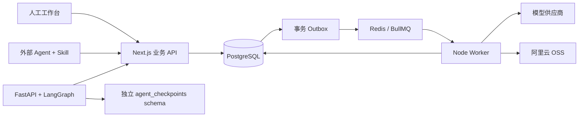

# FRAMEFLOW · AI 视频流水线 V1

面向内部团队与 Agent 的产品视频制作工作台。Next.js 是唯一业务入口，FastAPI + LangGraph 执行内置创作助手，BullMQ Worker 处理媒体生成和转存。

## 运行

需要 Node.js 22+、Python 3.10+、PostgreSQL 16、Redis 7、ffmpeg/ffprobe，以及可访问的阿里云 OSS。推荐生产环境使用 [部署说明](docs/deployment.md) 中的 Docker Compose。

```sh
cp .env.example .env
# 填写数据库、Redis、OSS、模型渠道和管理员配置。
# KEY_ENCRYPTION_SECRET 为 32 个随机字节的十六进制字符串。
npm ci
npm run db:generate
npm run db:migrate
npm run db:seed
npm run skill:build
npm run dev
```

另开两个终端：

```sh
npm run worker
python -m venv .venv
# 激活 .venv 后执行：
pip install -r agent/requirements.txt
python -m agent.run
```

Windows 使用 `python -m agent.run`，它选择 psycopg 所需的 Selector 事件循环。Linux 容器使用 Uvicorn。APP_URL 必须与浏览器实际访问的 origin 完全一致，登录和 Cookie 写操作需要同源请求。

本机开发实例的地址与管理员凭据保存在忽略的 `.runtime/access.txt`。该文件和 `.env` 不属于交付源码，不要上传或共享。生产管理员账号由首次 seed 创建；重复 seed 不覆盖已有密码和渠道配置。

在本次已初始化的 Windows 工作区，完成构建后可运行 `powershell -ExecutionPolicy Bypass -File scripts/start-local.ps1` 恢复 WSL 数据库、Redis 和三个应用进程。启动记录与本地日志位于 `.runtime`；该脚本使用已存在的私有 WSL 数据目录，不会覆盖其他 PostgreSQL 实例。

## 工作流

1. 创建产品，上传原始资料，编辑整理后的 Brief。原文件与解析结果分开保存。
2. 在「创意策划」创建创意批次、创意与策划案。人工评分、筛选、批注和 AI 协作均保存版本。
3. 在策划案下创建唯一的工业分镜表，添加镜头、连续性约束和资产版本。选定分镜图片后生成每页 9 格的确定性总览；镜头数量不限。
4. 在「资产制作」保存人物、场景、产品、道具与参考素材的提示词和候选。选定文件 ID 与资产修订版本可被制作脚本引用。
5. 在「视频制作」保存脚本，提交图片、音乐或视频批次。视频审批确认该批次的提示词、模型、参数、引用文件顺序与任务数量。Agent 没有审批能力。
6. 查看任务输出，上传剪辑后的成片并关联来源任务。未关联来源的成片显示“追溯信息不完整”。首版不自动剪辑、不接投放回流。

「产品资料」可以上传文本、Markdown、PDF、DOCX、图片、音频和视频。图片调用识图，音视频提取技术元数据并尝试转写；失败原因保留在文件记录，允许重试解析。供应商对某些音视频格式不支持时，原文件仍然可用。

## Agent 接入

在「Agent 接入」创建或选择 Key，检查权限和产品范围，点击「接入指令」即可复制到其他 Agent。完整指令包含所选密钥，仅人类登录会话可取得，响应禁止缓存，复制操作留审计但不记密钥正文。

- Skill：`/skills/ai-video-platform/SKILL.md`
- 安装包：`/skills/ai-video-platform.zip`
- OpenAPI：`/api/v1/openapi.json`
- 只读验证：`GET /api/v1/auth/me`

公共 Skill 无任何密钥。外部 Agent 将凭据保存在私有配置，通过 `AIVIDEO_BASE_URL` 和 `AIVIDEO_API_KEY` 读取。安装验证不会创建数据或生成媒体。示例与恢复约定见 [Skill API references](public/skills/ai-video-platform/references/api.md)。

管理员管理全团队 Key；成员只管理自己的 Key，权限不得高于所属成员。成员权限每次请求重新计算。API Key 不能调用人类审批、渠道凭据、成员管理或 Key 管理接口。

## 架构与数据约定



- Resource + 不可变 Revision 保存内容，业务类型通过 Zod 校验。修订需 `baseVersion`，并发冲突返回 409。来源引用固定具体版本，来源更新只产生提示，不覆盖历史。
- PostgreSQL 是任务事实来源。Outbox 与 Job 同事务创建，队列丢失或重启后可从任务状态补发。
- 提交、查询与转存分离。已有供应商任务 ID 时只继续查询；提交结果不明进入 `submission_unknown`，不会自动重新购买。
- 转存重试不重新生成。输出保存全部候选，任务仅在全部结果转存成功后标记成功。批次支持部分成功。
- OSS 使用 `aivideo/YYYYMMDD/{uuid}/{filename}`。签名 PUT 写入暂存 Key，确认文件大小、类型和 SHA-256 后移入新 Key，防止未过期的上传签名覆盖已批准文件。归档不删除文件。
- 模型结果只从已允许的 HTTPS 域名下载；供应商增加 CDN 时可配置 `RESULT_ALLOWED_HOSTS`，然后重试转存。
- 费用未获供应商明确账单时为 `unknown`，不把零当免费；明确的 `billed_cost` 记录为实际值。

## 验证

```sh
npm run typecheck
npm test
npm run test:integration
node --env-file=.env --import tsx tests/recovery.ts
python -m pytest agent/test_runtime.py
npx playwright test
npm run build
```

集成测试需要已启动的网站与数据库，会创建带“验收/测试”名称的记录。恢复测试的模型渠道为不可访问的测试域名，在审批前停用，不调用付费模型。`scripts/live-smoke.ts` 是显式的真实接口验收脚本，会产生图片与音乐费用；视频始终先进入待审批。不要当作常规 CI 执行。

当前实测结果与限制见 [验收记录](docs/acceptance.md)，故障处理与备份见 [运维说明](docs/deployment.md)。
